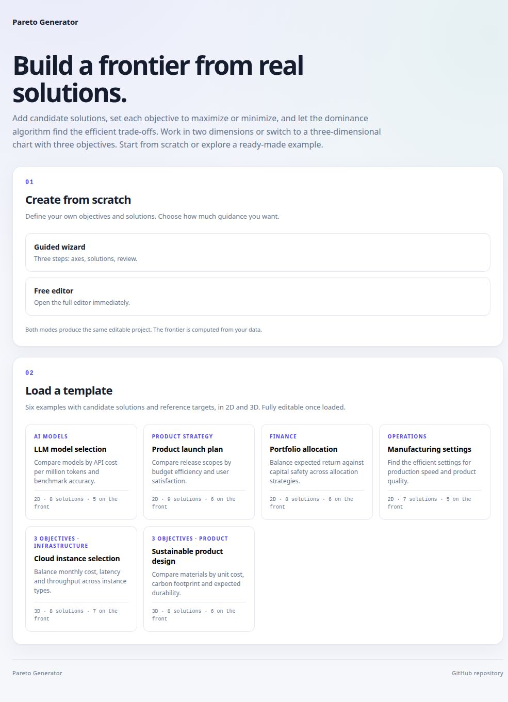
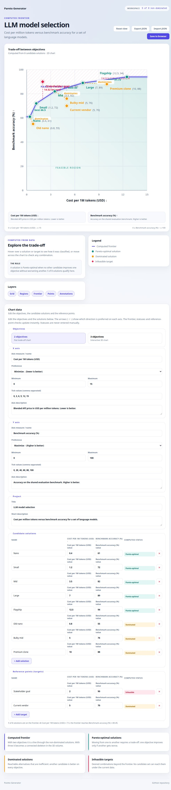
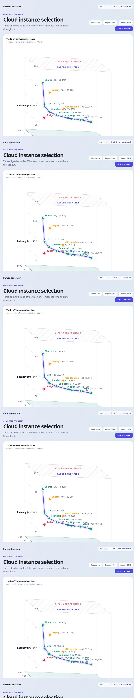

# Pareto Frontier Generator

An interactive generator of Pareto frontiers for **two or three objectives** with independently
configurable preferences: each objective can be **maximized** (higher is better) or **minimized**
(lower is better).

Instead of a fixed curve, the frontier is **computed from the candidate solutions you provide**.
The app finds every non-dominated solution, connects them into a frontier and classifies any
reference point or probed combination against it. Two-objective projects use a flat SVG chart;
three-objective projects use an interactive 3D chart that can be rotated by dragging.

## Screenshots

Click a label to expand the screenshot.

<details>
<summary>Show home page</summary>



Home page: start from scratch with the wizard or the free editor, or load one of the six templates.

</details>

<details>
<summary>Show 2D chart</summary>



Two-objective workspace: computed frontier, classified candidates and reference targets.

</details>

<details>
<summary>Show 3D chart</summary>



Three-objective workspace: orbits with a drag, with X/Y/Z probing and the on-screen control guide.

</details>

## How the frontier is computed

Every axis value is first mapped to a "higher is better" score with `objectiveScore`:

```
score(value, maximize) =  value
score(value, minimize) = -value
```

A candidate `a` dominates `b` when its score is at least as good on **every active objective** and
strictly better on one:

```
dominates(a, b) ⟺ ∀i: score(aᵢ) ≥ score(bᵢ)
                  ∧ ∃i: score(aᵢ) > score(bᵢ)
```

The Pareto-optimal set contains the candidates that no other candidate dominates.

- With **two objectives** the drawn frontier is the polyline through those solutions, sorted by
  increasing X and extended to the axis limits. The best achievable Y at any X is the linear
  interpolation of that polyline.
- With **three objectives** there is no single-valued frontier. The chart draws the non-dominated
  solutions inside the 3D objective box and connects them with a minimum spanning tree in
  normalized objective space, giving a readable skeleton of the efficient surface.

All the math lives in the pure module `frontend/src/domain/pareto.ts`.

## Quick start

```bash
cd frontend
npm install
npm run dev
```

Open the address shown by Vite (usually `http://localhost:5173`).

Other commands:

```bash
npm test            # automated domain and template tests (Vitest)
npm run typecheck   # TypeScript check
npm run build       # production build in frontend/dist
npm run preview     # preview the production build
```

The build uses relative asset paths, so `frontend/dist` can be served from any subpath.

## Home screen

On load you get two options:

- **Create from scratch**
  - **Guided wizard**: three steps — objectives and axes, candidate solutions, review.
  - **Free editor**: opens the workspace immediately with an empty project.
- **Load a template** — six ready-made, fully editable examples:
  - **LLM model selection** — cost per million tokens (minimize) vs. benchmark accuracy (maximize);
  - **Product launch plan** — budget efficiency vs. user satisfaction;
  - **Portfolio allocation** — expected return vs. capital safety;
  - **Manufacturing settings** — throughput vs. quality score;
  - **Cloud instance selection** (3D) — monthly cost ↓, latency ↓ and throughput ↑;
  - **Sustainable product design** (3D) — unit cost ↓, carbon footprint ↓ and durability ↑.

Projects saved with **Save to browser** also appear on the home screen and can be reopened or
deleted. Saving uses `localStorage`; no network requests are made.

## Working in the workspace

- Use the **Objectives** buttons in the **Chart data** panel to switch between 2 and 3 objectives.
  Existing points keep their coordinates; adding the third axis fills a neutral midpoint value.
- Edit axes, candidate solutions and reference points in the **Chart data** panel. Each axis shows
  an arrow: `↑` for maximize and `↓` for minimize. The frontier and all statuses recalculate on
  every change.
- Candidates are circles, reference points are diamonds. Their status — Pareto-optimal, dominated
  or infeasible — is always computed, never typed in manually.
- Hover over a point for details; click to pin the selection. Move across the chart to probe a
  combination anywhere in the plot, or focus the chart and use the arrow keys. In 3D, arrow keys
  change X/Y and `Page Up`/`Page Down` change Z; mouse probing uses the middle Z plane.
- In 3D, drag the chart to orbit it around the objectives, or focus the chart and press
  `Shift` + arrow keys. A visible guide below the chart lists the controls for each axis.
- Toggle the grid, regions, frontier, points and annotations with the layer buttons.
- **Export JSON** downloads the current project; **Import JSON** loads one back. Imported and saved
  files are validated and sanitized before use.
- **Save to browser** stores up to 12 projects locally. Saving reports success, an unchanged state
  or an error, and the app warns before leaving with unsaved edits.
- **Reset view** restores layers, the default 3D angle and clears the selection without touching
  your data.

The frontend interface and the documentation in `doc/` are entirely in English.

## Structure

```
.
├── AGENTS.md              # instructions for AI agents working on the repo
├── LICENSE                # GNU AGPL v3 license text
├── README.md              # this file
├── frontend/              # Vite + React + TypeScript application (pure SVG)
│   └── src/
│       ├── domain/        # pure Pareto analysis, tests and templates
│       ├── components/    # home, wizard, workspace, 2D/3D charts and editors
│       ├── storage.ts     # browser-local saved projects and JSON import/export
│       └── theme.ts       # shared palette
├── backend/               # reserved for future server code (store, db, API)
└── doc/                   # project documentation
    ├── screenshots/       # README screenshots
    ├── SPEC.md
    ├── BRAND.md
    ├── PROCESS.md
    ├── CODE_STANDARDS.md
    └── TECH_STACK.md
```

## Documentation

Functional specifications, visual style, working process, code standards and the technology
stack are described in the [`doc/`](doc/) folder.

## License

This project is licensed under the **GNU Affero General Public License version 3**
(`AGPL-3.0-only`). See [LICENSE](LICENSE) for the full text.
